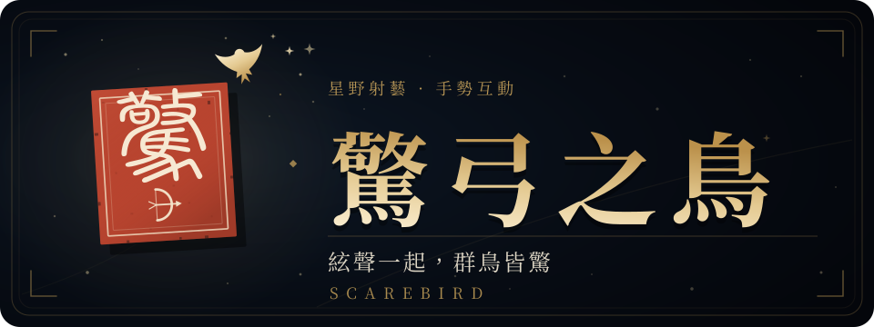

<p align="center">
  
</p>

<p align="center"><em>灵感取自《战国策·楚策四》更羸虚弓落雁：“闻弦音，引而高飞，故疮陨也。”</em></p>

<p align="center">
  <a href="https://niyongsheng.github.io/scarebird/"></a>
  
  
</p>

<p align="center">
  一款基于 <b>Boids 鸟群算法</b>、支持 <b>摄像头手势</b> 的星野射艺小游戏。<br>
  引弓虚发，弓上无箭，只以弦声惊起飞鸟，守住星田里的星穗。
</p>

## 玩法

九十秒内，飞鸟成波次从画面外飞入星田，落地啄食会消耗星穗；星穗见底或时间耗尽，游戏结束。

- **瞄准** — 移动鼠标、手指或食指指尖，准星即弦声落点
- **拉弓** — 按住蓄力，蓄得越满，弦声波及范围越大
- **放弦** — 松手的瞬间，声波飞向落点，范围内鸟群受惊四散
- **连击** — 连续命中最高 ×9，连击窗口 8 秒；一弦惊起 6 只以上触发“惊群”加分
- **共鸣** — 命中积攒“弦鸣”，满弦后下一弦范围 ×1.55、得分 ×2
- **金羽回穗** — 惊起金羽可补回 6 点星穗

| 鸟种 | 分值 | 特点 |
| --- | --- | --- |
| 麻雀 | 1 | 最常见 |
| 乌鸦 | 2 | 飞得更快 |
| 金羽 | 5 | 最灵敏，可回穗 |

弦囊常备六道弦音，每放一弦约 0.45 秒聚回一道。结算按总分评出段位：初闻弦音 → 弦上清风 → 一弦惊群 → 惊弓之鸟 → 百步穿杨 → 射日神手。

## 操作

| 设备 | 瞄准 | 拉弓 | 放弦 |
| --- | --- | --- | --- |
| 鼠标 | 移动 | 按住左键 | 松开 |
| 触控 | 手指位置 | 按住屏幕 | 松开 |
| 手势 | 食指指尖 | 张开拇指与食指 | 合拢拇指与食指 |

`P` / `Esc` 暂停 · `M` 静音 · `G` 对局中开关手势 · `F` 全屏（右上角按钮同效） · 结算页 `R` / `Space` 再来一局、`S` 分享、`Esc` 返回

## 本地运行

```bash
npm install
npm run dev
```

## 部署

推送到 `main` 后，GitHub Actions 会自动构建并发布到 [GitHub Pages](https://niyongsheng.github.io/scarebird/)；

<details>
<summary><b>技术细节</b></summary>

- **鸟群** — `src/js/Boids.js` 为完整 Reynolds Boids：分离、对齐、聚合、寻路、受惊逃逸，64px 空间网格支撑 200+ 只鸟同屏
- **手势** — `src/js/GestureController.js` 封装 MediaPipe Hands：食指指尖定位准星，拇指与食指距离映射蓄力，450ms 无结果判定脱手
- **音效** — `src/js/Audio.js` 全部由 WebAudio 现场合成：分层蓄力、飞行哨音、五层命中、鸟鸣与连击；支持左右声像与轻压缩
- **美术** — 深空、飞鸟、星屑、弓与星球地平线均由 Canvas 程序绘制，无外部美术素材
- **调试** — 控制台可访问 `window.__game`，例如 `window.__game.scene.start('Game', { useGesture: false })`

</details>

## 素材与致谢

- **LXGW Seal / 霞鹜篆书**（SIL OFL 1.1）— 印章小篆字形，授权见 `public/fonts/OFL-LXGWSeal.txt`
